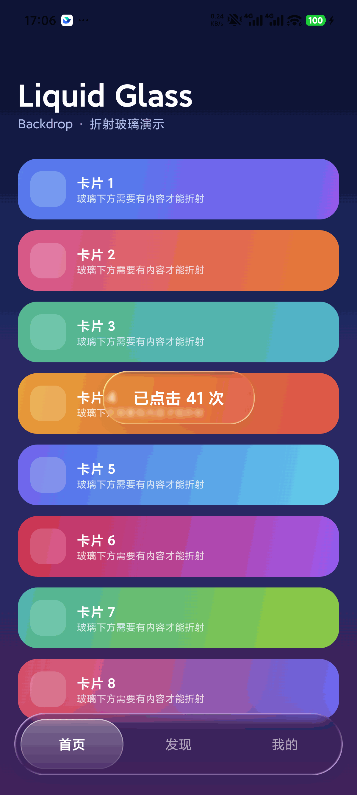

# android-liquid-glass

[English](README.md) | [简体中文](README.zh-CN.md)

An agent skill for building Apple-style **liquid glass** surfaces in **Android Jetpack Compose** with the [Backdrop](https://github.com/Kyant0/AndroidLiquidGlass) library (`io.github.kyant0:backdrop`) — source/surface wiring, the effect stack, highlight styles, contrast requirements, performance budgets, and a device-verified reference implementation, distilled into rules you can apply directly.

<p align="center">
  <a href="assets/demo-backdrop.png">
    
  </a>
</p>

*Real device screenshot (Xiaomi, Android 16): a glass button floating over scrolling content and a glass bottom tab bar — both refracting the cards beneath them. Rendered entirely with `backdrop:1.0.6` following this skill. Click to view full resolution.*

> **TL;DR** — Apple's Liquid Glass is not "add a blur". It is **refraction**: the glass edge bends the content beneath it, highlights run along the rim, and depth is expressed with light instead of shadows.

## What's inside

| File | Purpose |
|---|---|
| `SKILL.md` | The full skill: mental model, effect stack (verified API signatures), three iron rules, highlight styles, in-glass "material chip" technique, degradation, acceptance checklist, symptom lookup |
| `references/full-example.md` | A complete, **machine-verifiable** implementation: Gradle/AGP/Compose BOM configuration + a full page of Kotlin, tested on a physical device (Android 16) |
| `assets/demo-backdrop.png` | Real-device screenshot of the reference implementation |
| `LICENSE` | MIT |
| `THIRD_PARTY_NOTICES.md` | Attribution and license info for the Backdrop library (Apache-2.0) |
| `README.md` / `README.zh-CN.md` | This doc, in English and Chinese |

## Quick start

1. Add the dependency (pick the version that matches your `compileSdk`):

   ```kotlin
   implementation("io.github.kyant0:backdrop:1.0.6")   // minCompileSdk 36
   implementation("io.github.kyant0:shapes:1.2.0")
   // or, if your compileSdk >= 37: backdrop 2.0.1 + shapes 1.2.1
   ```

2. Wire **source** and **surface** as siblings (never parent/child):

   ```kotlin
   val backdrop = rememberLayerBackdrop()

   Box(Modifier.fillMaxSize()) {
       Column(Modifier.fillMaxSize().layerBackdrop(backdrop)) { /* content */ }

       Row(
           Modifier
               .align(Alignment.BottomCenter)
               .drawBackdrop(
                   backdrop = backdrop,
                   shape = { RoundedCornerShape(35.dp) },
                   effects = {
                       blur(26f)
                       lens(refractionHeight = 34f, refractionAmount = 34f)
                   },
                   highlight = { Highlight(width = 1.2.dp) },
               )
       ) { /* tabs */ }
   }
   ```

3. Make sure the area **under the glass has contrast** (light/dark or hue changes). This is the #1 cause of "my glass looks like flat plastic" — see *Iron rule 2* in `SKILL.md`.

## Highlights of the ruleset

- **Effect order matters**: `blur` before `lens`, or refraction detail gets washed out.
- **Parameter by area**: small button `blur 10 / lens 18`; 70dp bar `blur 26 / lens 34`.
- **Circular controls need `HighlightStyle.Plain`**: the default style is directional and nearly vanishes on a circle.
- **Never stack glass on glass**: elements *inside* a glass bar use a gradient "material chip", not another `drawBackdrop`.
- **Silent degradation**: `lens()` no-ops on devices without `RuntimeShader` — plan a fallback and verify on real hardware.

## Verified environments

| Item | Value |
|---|---|
| Verified on | Xiaomi 23127PN0CC, Android 16 (physical device) |
| Compose BOM | 2025.11.00 (Compose 1.9.4) |
| AGP / Gradle / JDK | 8.13.2 / 8.13 / JDK 21 |
| backdrop | 1.0.6 + shapes 1.2.0 (minCompileSdk 36) |

Reproducibility check: a brand-new project following only this skill compiled on the first attempt (39 s, zero errors) with a completely different layout (top nav bar + bottom play bar + circular FAB) and rendered correctly on device.

## License

This skill's text and example code are released under the **MIT License**. See [LICENSE](LICENSE).

The [Backdrop library](https://github.com/Kyant0/AndroidLiquidGlass) is **not** included in or redistributed by this repository; it stays under its own **Apache License 2.0**. See [THIRD_PARTY_NOTICES.md](THIRD_PARTY_NOTICES.md).

Apple, Liquid Glass, Android, and Jetpack Compose are trademarks of their respective owners. This project claims no affiliation with or endorsement by Apple, Google, or Kyant0.
