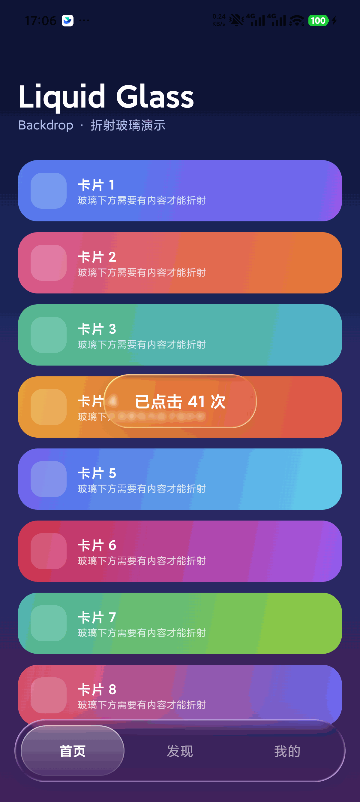

# android-liquid-glass

[English](README.md) | [简体中文](README.zh-CN.md)

一个面向 AI Agent 的技能（skill），用于在 **Android Jetpack Compose** 中，借助 [Backdrop](https://github.com/Kyant0/AndroidLiquidGlass) 库（`io.github.kyant0:backdrop`）构建 Apple 风格的**液态玻璃**界面——把 source/surface 接线、effect stack、高光样式、对比度要求、性能预算，以及一份经过真机验证、可编译的参考实现，提炼成可以直接套用的规则。



*真机截图（小米，Android 16）：玻璃按钮悬浮在滚动内容之上，底部是玻璃标签栏——两者都在折射身下的卡片。完全按本 skill 用 `backdrop:1.0.6` 渲染。*

> **一句话** —— Apple 的 Liquid Glass 不是"加个模糊"，而是**折射**：玻璃边缘让背后的内容弯折，高光沿边缘走，深度靠光而不是阴影表达。

## 文件结构

| 文件 | 用途 |
|---|---|
| `SKILL.md` | 技能正文：心智模型、effect stack（已核对 API 签名）、三条铁律、高光样式、玻璃内"材质片"技法、降级策略、验收清单、症状速查 |
| `references/full-example.md` | 完整可编译实现：Gradle/AGP/Compose BOM 配置 + 整页 Kotlin，真机（Android 16）验证过 |
| `assets/demo-backdrop.png` | 参考实现的真实设备截图 |
| `LICENSE` | MIT |
| `THIRD_PARTY_NOTICES.md` | Backdrop 库（Apache-2.0）的归属与许可说明 |
| `README.md` / `README.zh-CN.md` | 本说明的英文版与中文版 |

## 快速开始

1. 添加依赖（按你的 `compileSdk` 选版本）：

   ```kotlin
   implementation("io.github.kyant0:backdrop:1.0.6")   // minCompileSdk 36
   implementation("io.github.kyant0:shapes:1.2.0")
   // 若 compileSdk >= 37，可用 backdrop 2.0.1 + shapes 1.2.1
   ```

2. 把 **source** 与 **surface** 接成兄弟节点（绝不能是父子）：

   ```kotlin
   val backdrop = rememberLayerBackdrop()

   Box(Modifier.fillMaxSize()) {
       Column(Modifier.fillMaxSize().layerBackdrop(backdrop)) { /* 内容 */ }

       Row(
           Modifier
               .align(Alignment.BottomCenter)
               .drawBackdrop(
                   backdrop = backdrop,
                   shape = { RoundedCornerShape(35.dp) },
                   effects = {
                       blur(26f)
                       lens(refractionHeight = 34f, refractionAmount = 34f)
                   },
                   highlight = { Highlight(width = 1.2.dp) },
               )
       ) { /* tabs */ }
   }
   ```

3. 确保玻璃**正下方有对比度**（明暗或色相突变）。这是"我的玻璃像半透明塑料"的头号原因——见 `SKILL.md` 的*铁律 2*。

## 规则要点

- **effect 顺序有意义**：先 `blur` 再 `lens`，反过来折射细节会被糊掉。
- **参数按面积给**：小按钮 `blur 10 / lens 18`；70dp 高的条 `blur 26 / lens 34`。
- **圆形控件必须用 `HighlightStyle.Plain`**：默认样式是方向性的，在圆上几乎不可见。
- **绝不玻璃叠玻璃**：玻璃条*内部*的元素用渐变"材质片"，不要再套一层 `drawBackdrop`。
- **静默降级**：不支持 `RuntimeShader` 的设备上 `lens()` 会静默失效——要准备降级方案并在真机验收。

## 验证环境

| 项 | 值 |
|---|---|
| 验证设备 | 小米 23127PN0CC，Android 16（真机） |
| Compose BOM | 2025.11.00（Compose 1.9.4） |
| AGP / Gradle / JDK | 8.13.2 / 8.13 / JDK 21 |
| backdrop | 1.0.6 + shapes 1.2.0（minCompileSdk 36） |

复现性记录：一个全新工程**只照本 skill**、用完全不同的布局（顶部导航栏 + 底部播放条 + 圆形 FAB）编写，**首次构建即通过**（39 秒，零错误），真机渲染正常。

## 许可

本 skill 的文字与示例代码以 **MIT 协议**开源，见 [LICENSE](LICENSE)。

[Backdrop 库](https://github.com/Kyant0/AndroidLiquidGlass)**不包含在**本仓库中、也**不由本仓库分发**；它遵循自身的 **Apache License 2.0**。详见 [THIRD_PARTY_NOTICES.md](THIRD_PARTY_NOTICES.md)。

Apple、Liquid Glass、Android、Jetpack Compose 为各自所有者的商标。本项目与 Apple、Google、Kyant0 无隶属或背书关系。
